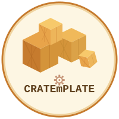

<p align="center">
  
</p>

# CRATEmPLATE

[](https://github.com/mlavrinenko/cratemplate/actions/workflows/ci.yml)
[](https://github.com/cargo-generate/cargo-generate)

An opinionated [cargo-generate](https://github.com/cargo-generate/cargo-generate) template for Rust projects.

## Usage

```bash
cargo generate gh:mlavrinenko/cratemplate
# or using nix:
nix run nixpkgs#cargo-generate -- generate --git https://github.com/mlavrinenko/cratemplate
```

You'll be prompted for project name, GitHub username, description, license, and
crate kind (`bin` or `lib`).

## What you get

Both crate kinds share the gates and conventions below.

- Rust 2024 with a pinned toolchain, `rustfmt`, and clippy at `deny`; a `bin`
  with a `clap` CLI or a `lib` with a small documented API, as one crate or a
  `crates/` workspace.
- One `just check` gate for fmt, clippy, tests, unused deps, file size,
  copy-paste, and dependency drift — every arm memoized by
  [mmz](https://github.com/mlavrinenko/mmz) so unchanged inputs skip the work.
  CI runs the same gate.
- Coverage via `cargo-llvm-cov` (70% floor) and a CRAP gate via `cargo-crap`.
- Inline `#[cfg(test)]` units, one `tests/it/` integration binary, `assert_cmd`
  + `predicates` CLI tests, and `ejectest` extraction when a file nears the
  linecop cap.
- A Nix flake and direnv dev shell with the pinned toolchain and gate tools;
  entering it installs the tracked pre-commit hook.
- GitHub Actions CI, Pages deployment, and a tag-driven release that publishes
  to crates.io.
- `CHANGELOG.md`, `CONTRIBUTING.md`, `AGENTS.md`, and a choice of MIT,
  Apache-2.0, dual, or GPL-3.0-only licensing.

## Template maintenance

`just docs-sync` renders the template docs; `just validate bin` and
`just validate lib` gate both kinds (or `just mmz validate <kind>` to skip a
re-run when `template/` is unchanged; a plain `just validate` records no pass).
`just check-docs` holds the linecaps and `just check-tasks` the backlog; see
[AGENTS.md](AGENTS.md) for the rules. The seam between referenced, generated
and copied template pieces is decided in
[docs/decision/reference-not-copy.md](docs/decision/reference-not-copy.md).
The `description` placeholder rejects quotes, backslashes, CR/LF and other C0 controls and DEL because it lands in TOML and doc comments verbatim.
